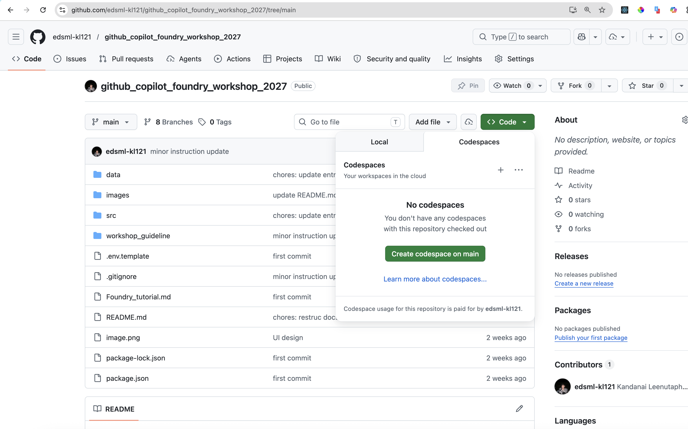
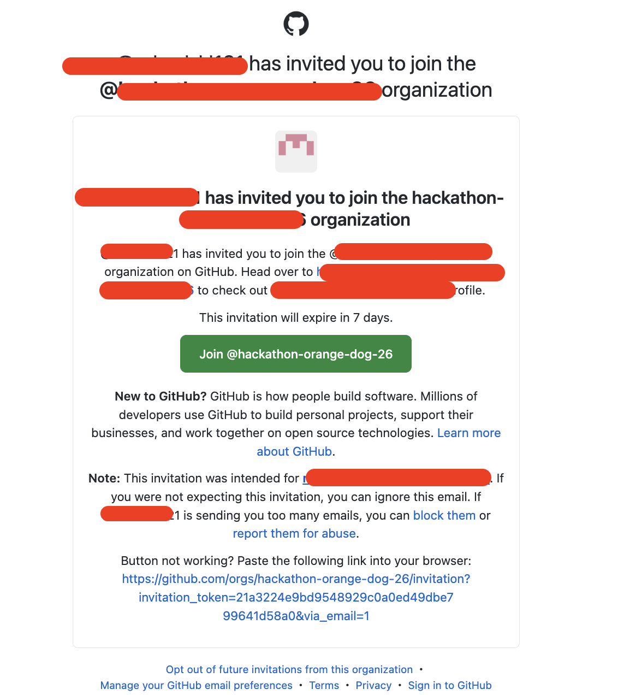
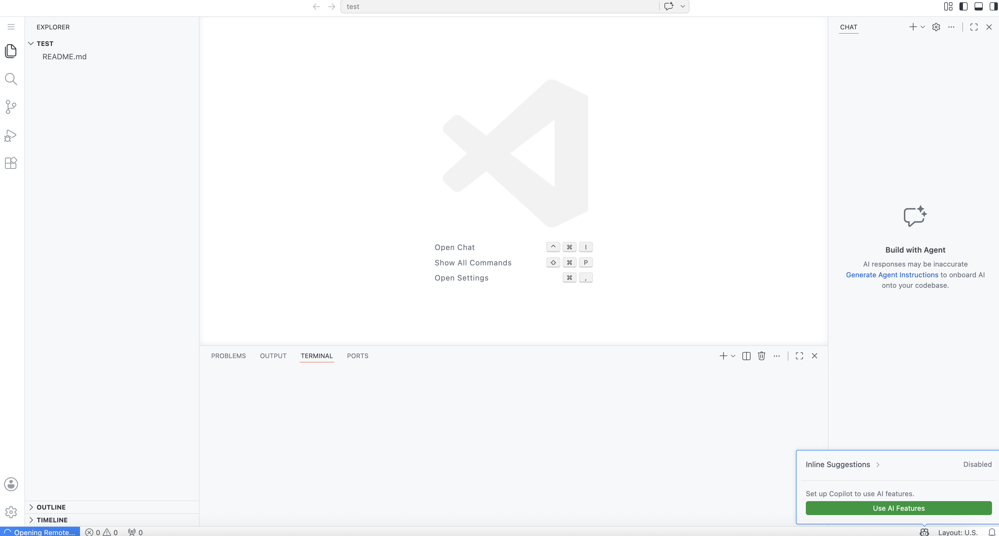
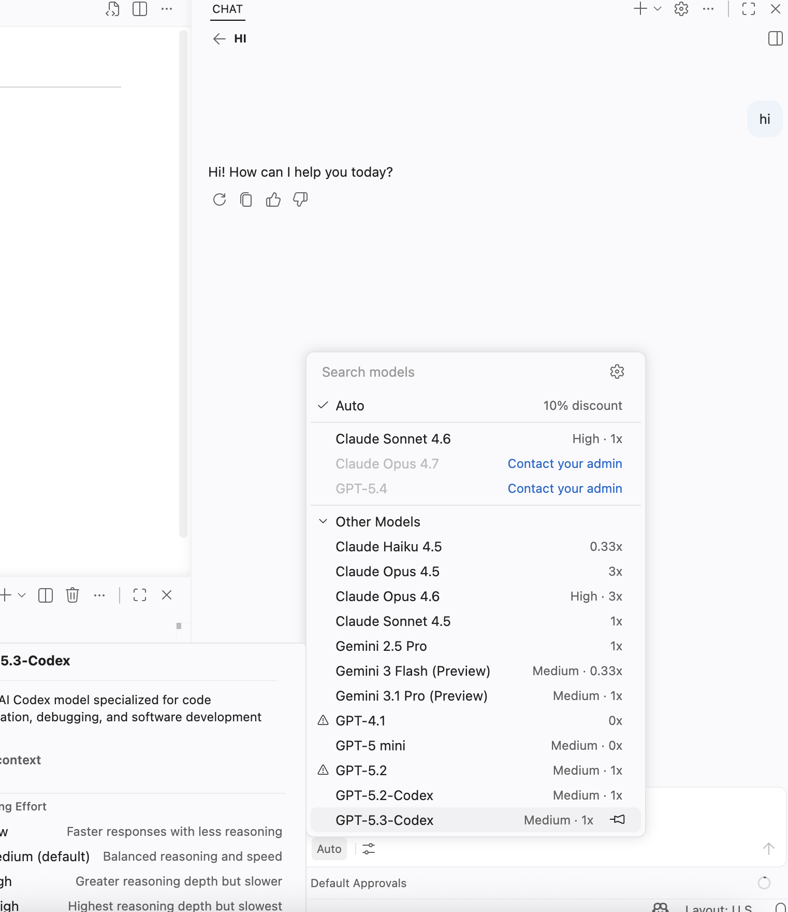
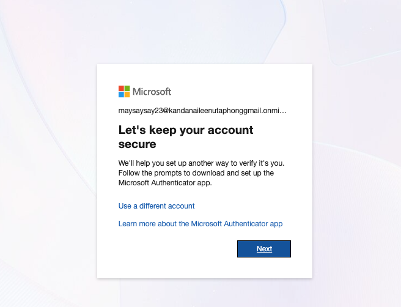
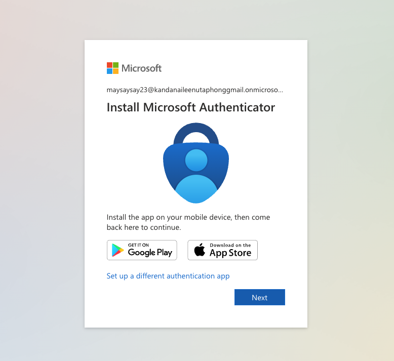
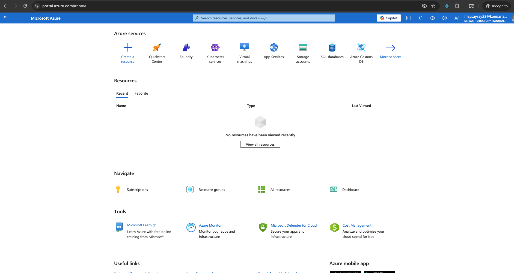
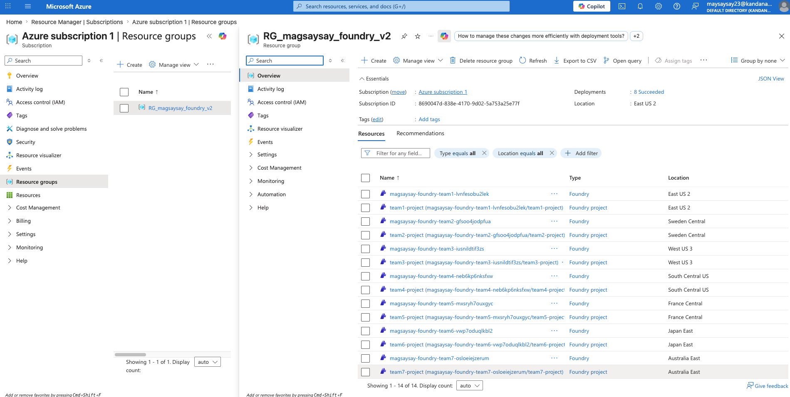
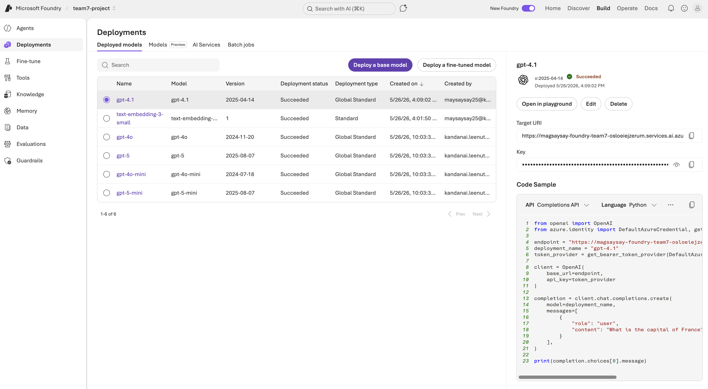
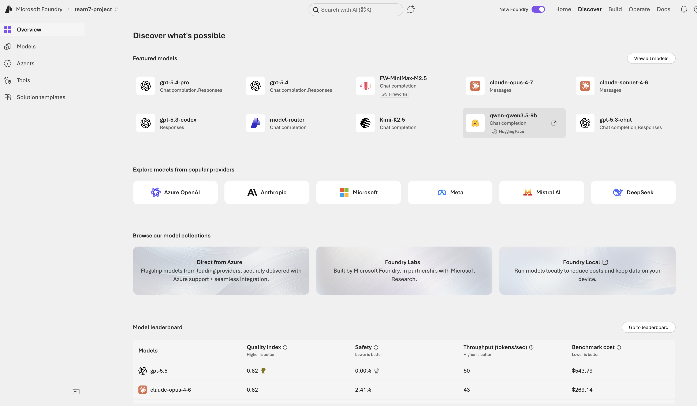

# Lab 1: Setup

**Goal:** finish this lab with a working environment and every check green, so the later labs only need you to follow the steps.

**Time:** 30 to 40 minutes

| Step | What you do | Done when |
|---|---|---|
| 1.0 | Accounts, Codespaces, GitHub Copilot | Copilot Chat answers in VS Code |
| 1.1 | Sign in to Azure and open your Foundry project | You can see the project in ai.azure.com |
| 1.2 | Check (or deploy) the chat and vision models | Two deployments in **Succeeded** state |
| 1.3 | Copy endpoint, key and project endpoint | You have 3 values in a notepad |
| 1.4 | Confirm Document Intelligence (OCR) | You know your `cognitiveservices` endpoint |
| 1.5 | Get a Web IQ API key | You have a `WEBIQ_API_KEY` |
| 1.6 | Create `.env`, install Python packages, run setup check | All rows PASS (Web IQ may be SKIP) |
| 1.7 | Run offline tests and pipeline | All Python tests pass and you see 4 outcomes |

> **Instructor-provided environment?** If your instructor gave you a credentials block, skip the "create" parts of 1.1 and 1.2 and only do the "check" parts.

---

## Lab 1.0: Accounts, Codespaces and GitHub Copilot

1. Share your GitHub username or email with the instructor before the event so a Copilot license can be assigned. Accept the email invitation to join the workshop organization.

2. **Preferred option: GitHub Codespaces.** Open this repository on GitHub, then select **Code > Codespaces > Create codespace on main**.

   

   Codespaces already has Python 3.11 and the Copilot extension. If the page is blocked by a firewall, tell the instructor now.

3. In VS Code, confirm the **GitHub Copilot** extension is installed (Codespaces does this for you).

   

4. Sign in to GitHub Copilot.

   

5. Open Copilot Chat and confirm several models are available.

   

**Backup option (local machine).** Install [VS Code](https://code.visualstudio.com/download) and [Python 3.11+](https://www.python.org/downloads/), then clone the repository:

```bash
git clone <this-repo-url>
cd github_copilot_foundry_ap_verification_workshop
python3 --version
```

**For Lab 3:** install [Node.js 22 LTS or later](https://nodejs.org/en/download) for the React/Vite frontend. In Codespaces, check the available version before the app lab:

```bash
node --version
npm --version
```

Node.js is frontend tooling only. Backend, AI examples and business rules still use Python. The policy, invoice PDFs, scan, database descriptions and requirements transcript are Thai; identifiers and ISO dates remain unchanged.

**Checkpoint 1.0:** Copilot Chat replies to `hello` in VS Code.

---

## Lab 1.1: Sign in to Azure and open your Foundry project

1. Go to [portal.azure.com](https://portal.azure.com) and sign in with the account from your instructor (or your own).

   

2. If prompted, set up MFA with the **Microsoft Authenticator** app and scan the QR code.

   
   

3. Open **Subscriptions > your subscription > Resource groups**. You should see a **Foundry** resource (type *Foundry* / *Azure AI Services*) in your resource group.

   

4. Open [ai.azure.com](https://ai.azure.com) and select your project.

**Only if you have no Foundry project yet (own subscription):**

1. In [ai.azure.com](https://ai.azure.com), select **Create new > Foundry resource**.
2. Enter a project name (for example `ap-verify`), choose a region that offers both GPT models and Document Intelligence (for example *East US 2* or *Sweden Central*), then select **Create**.
3. Wait 2 to 3 minutes for the resource and project to finish creating.

**Checkpoint 1.1:** the Foundry portal shows your project home page.

---

## Lab 1.2: Check (or deploy) the chat and vision models

The workshop uses two deployments:

| Purpose | Default deployment name | Used by |
|---|---|---|
| Chat, Text2SQL, File Search, memo writing | `gpt-4.1-mini` | examples 1, 3, 4, 5, 6 |
| Vision OCR (reads images) | `gpt-4.1` | example 2 `--vision` |

1. In the Foundry portal, open **Build > Models** (also shown as **Deployments**).

   

2. Confirm both deployments exist and show **Succeeded**. Write down their **exact deployment names**.

**Only if they are missing:**

1. Open **Discover > Models**, search for the model, select it, then select **Deploy > Default settings**.

   

2. Repeat for the second model. Any current GPT model that supports images works (for example `gpt-5-mini` for chat and `gpt-5` for vision). You only need to put the names in `.env` in Lab 1.6.

**Checkpoint 1.2:** you have two deployment names written down.

---

## Lab 1.3: Copy endpoint, key and project endpoint

1. In the Foundry portal, open the project **Overview** page.
2. Copy these values into a notepad:

| `.env` variable | Where to find it | Example format |
|---|---|---|
| `FOUNDRY_ENDPOINT` | Overview > **Azure OpenAI** endpoint | `https://my-res.openai.azure.com/` |
| `FOUNDRY_API_KEY` | Overview > **API Key** (Key 1) | 32 to 84 characters |
| `FOUNDRY_PROJECT_ENDPOINT` | Overview > **Foundry project endpoint** | `https://my-res.services.ai.azure.com/api/projects/ap-verify` |

If your instructor gave you a credentials block, map it like this:

| Credentials block line | `.env` variable |
|---|---|
| AOAI Endpoint | `FOUNDRY_ENDPOINT` |
| API Key 1 | `FOUNDRY_API_KEY` |
| Project Endpoint | `FOUNDRY_PROJECT_ENDPOINT` |

> **Security:** the API key is a secret. Never paste it into chat, screenshots or a commit. `.env` is already in `.gitignore`.

**Checkpoint 1.3:** three values in your notepad.

---

## Lab 1.4: Confirm Document Intelligence (OCR)

A Foundry resource is also an Azure AI Services resource, so **Document Intelligence is already included**. It uses the same API key and this endpoint format:

```
https://<resource-name>.cognitiveservices.azure.com/
```

The code derives it from `FOUNDRY_ENDPOINT` automatically. Only set `FOUNDRY_DOCINTEL_ENDPOINT` if you use a separate Document Intelligence resource.

**Optional: try it with no code**

1. Open [Document Intelligence Studio](https://documentintelligence.ai.azure.com/studio) and select **Layout**.
2. Choose your subscription and Foundry resource.
3. Upload `data/invoices/INV-TTS-2026-118.pdf` and select **Run analysis**.
4. Check that invoice text and line-item tables are found. Layout does not return named invoice fields; Lab 2.2 uses the chat model to map the Layout output into invoice JSON.

**Checkpoint 1.4:** you know your `cognitiveservices` endpoint (or you will let the code derive it).

---

## Lab 1.5: Get a Web IQ API key

**Microsoft Web IQ** gives agents grounded web search results (passages with URLs). We use it to check information that changes over time, such as tax rates.

1. Go to [webiq.microsoft.ai/profiles](https://webiq.microsoft.ai/profiles) and sign in.
2. Create a profile (or open the default one) and copy its **API key**.
3. Optional quick test (replace the placeholder):

```bash
curl -s https://api.microsoft.ai/v3/search/web \
  -H "x-apikey: <YOUR_WEBIQ_API_KEY>" \
  -H "content-type: application/json" \
  -d '{"query":"Thailand VAT rate","maxResults":2,"contentFormat":"passage","maxLength":300}'
```

You should get JSON with a `webResults` array (`title`, `url`, `content`).

> No Web IQ key? You can still do every other lab. Web IQ steps show **SKIP** instead of failing.

**Checkpoint 1.5:** you have a Web IQ key (or you decided to skip it).

---

## Lab 1.6: Create `.env`, install packages, run the setup check

1. Create your `.env` from the template:

```bash
cp .env.template .env
```

2. Open `.env` and replace the placeholders with the values from Labs 1.2 to 1.5:

```dotenv
FOUNDRY_ENDPOINT=https://<resource-name>.openai.azure.com/
FOUNDRY_API_KEY=<your-key>
FOUNDRY_PROJECT_ENDPOINT=https://<resource-name>.services.ai.azure.com/api/projects/<project-name>
FOUNDRY_DEPLOYMENT_CHAT=<chat-deployment-name>
FOUNDRY_DEPLOYMENT_VISION=<vision-deployment-name>
WEBIQ_API_KEY=<your-webiq-key>
```

Leave `FOUNDRY_DOCINTEL_ENDPOINT`, `AP_POLICY_VECTOR_STORE_ID` and `AP_AS_OF_DATE` as they are.

3. Create and activate a Python virtual environment, then install the workshop dependencies:

```bash
python3 -m venv .venv
source .venv/bin/activate          # Windows: .venv\Scripts\activate
pip install -r requirements.txt
```

4. Run the setup check:

```bash
python python_examples/00_check_setup.py
```

Expected result (the Python example prints one status row per check):

```
PASS  .env configuration                  https://<resource>.openai.azure.com/
PASS  Chat model (gpt-4.1-mini)           ready
PASS  Vision model (gpt-4.1)             ready
PASS  Document Intelligence (OCR)         https://<resource>.cognitiveservices.azure.com/
PASS  Web IQ                               1 result(s)
PASS  AP database                          9 invoices loaded

All required checks passed.
```

If a row says **FAIL**, use the troubleshooting table at the end of this lab, fix `.env`, and rerun the Python setup check.

**Checkpoint 1.6:** all rows PASS (Web IQ may be SKIP).

---

## Lab 1.7: Run the offline tests and the pipeline (no Azure calls)

This proves the AP business rules work before we add AI.

1. Run the unit tests:

```bash
python -m unittest discover -s python_examples -p 'test_*.py'
```

Expected: all tests pass, including Thai document/data consistency and OCR bank parsing.

2. Run the capstone pipeline in offline mode. It skips OCR (uses `data/invoices/ground_truth.json`) and skips all AI calls:

```bash
python python_examples/06_ap_verification_pipeline.py --offline
```

3. Check that you see these four outcomes:

| Invoice | Outcome | Why | Approver |
|---|---|---|---|
| `INV-SOS-2026-0415` | APPROVED | Price, quantity and VAT all match | AP Manager (> THB 50,000) |
| `INV-TTS-2026-118` | ON HOLD | Unit price +8.7% over PO, limit 2% | AP Manager |
| `INV-BEL-7781` | ON HOLD | Billed 120 pallets, only 100 received | AP Manager |
| `INV-CMP-2026-0057` | ON HOLD | Bank account differs from vendor master | AP Officer |

**Checkpoint 1.7:** you see the same four outcomes. Setup is complete. Continue to [Lab 2: Capabilities](02_capabilities_lab.md).

---

## Troubleshooting

| Symptom | Likely cause and fix |
|---|---|
| `Missing or placeholder value for FOUNDRY_ENDPOINT` | `.env` not created or still has placeholders. Run `cp .env.template .env` and edit it. |
| `401` on chat or vision | Wrong `FOUNDRY_API_KEY`, or the key belongs to a different resource than `FOUNDRY_ENDPOINT`. |
| `404 DeploymentNotFound` | `FOUNDRY_DEPLOYMENT_CHAT` or `FOUNDRY_DEPLOYMENT_VISION` does not match a deployment name in **Build > Models**. Names are case-sensitive. |
| Vision check fails, chat passes | The vision deployment is a model without image support. Deploy an image-capable GPT model. |
| Document Intelligence `404` | Endpoint is wrong. Set `FOUNDRY_DOCINTEL_ENDPOINT=https://<resource>.cognitiveservices.azure.com/`. |
| Document Intelligence `401` | Using a separate Document Intelligence resource with a different key. Use the same Foundry resource or ask the instructor. |
| Web IQ `401` or `403` | Wrong or inactive Web IQ key. Recopy it from webiq.microsoft.ai/profiles. |
| `429 Too Many Requests` | Shared quota. Wait 30 to 60 seconds and try again. |
| Python cannot find a file or module | Activate `.venv` and run the command from the repository root. |
