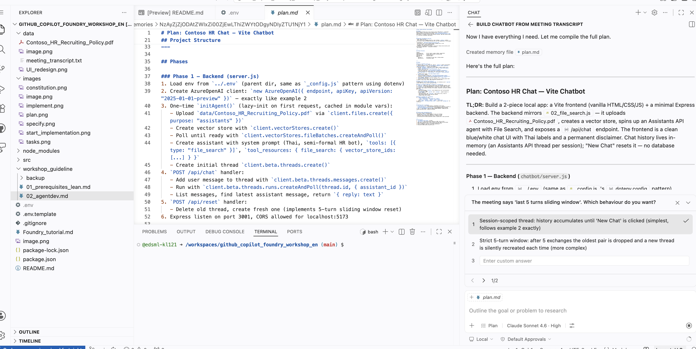
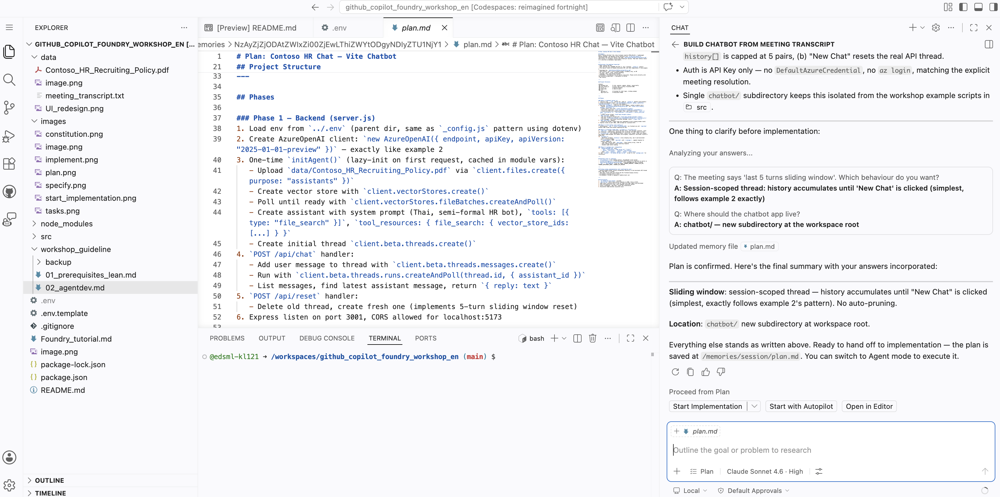
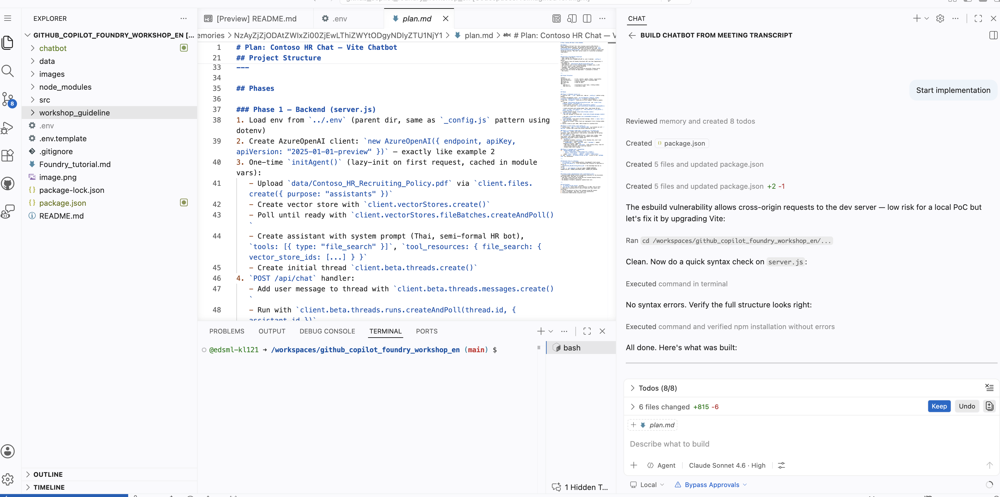

# Lab 3: Build "Contoso AP Verify" with GitHub Copilot

**Goal:** turn the Thai requirements meeting into a local app with a **React/Vite frontend using Node.js** and a **Python/FastAPI backend**. All OCR, AI calls, SQL execution and verification rules remain in Python.

**Time:** 45 to 60 minutes

**Before you start:** finish Labs 1 and 2, activate `.venv`, and confirm Node.js 22 LTS or later is installed:

```bash
node --version
npm --version
```

The app files are intentionally not supplied. You build `frontend/` and `backend/` with Copilot during this lab. The repository provides the Python capability interfaces and dependencies.

## Lab 3.1: Read the requirements

Open `data/meeting_transcript.txt`. The meeting, policy, invoices and descriptive database values are in Thai. Technical identifiers, JSON keys, status codes and ISO dates retain their original format.

```
Thai invoice / user question
            |
            v
React frontend (Node.js / Vite, port 5173)
            |
       /api/* proxy
            |
            v
Python FastAPI backend (port 8000, local only)
            |
            +--> workshop_api.py --> OCR / File Search / Text2SQL / Web IQ
            +--> verify.py + SQLite --> deterministic recommendation
            |
            v
Thai UI + evidence --> human decision
```

Node.js serves and builds the frontend only. Do not add a Node.js AI backend. API keys stay in the root `.env`, loaded only by Python. Never put secrets in `VITE_*` variables, browser storage or responses.

## Lab 3.2: Plan mode

1. Open Copilot Chat and switch to **Plan** mode.
2. Choose a strong reasoning model.
3. Paste this prompt:

```text
Read data/meeting_transcript.txt first. It is the Thai requirements and acceptance scenarios.
Build Contoso AP Verify locally with:
- frontend/: React + TypeScript + Vite, Node.js 22 LTS or later.
- backend/__init__.py and backend/main.py: Python + FastAPI.
- No Streamlit, Express, Node.js AI calling code or cloud deployment.

Reuse existing server-side Python interfaces:
- OCR: python_examples/workshop_api.py:extract_invoice
- Policy Vector Search: python_examples/workshop_api.py:ask_policy
- Text2SQL: python_examples/workshop_api.py:ask_data
- Web IQ: python_examples/workshop_api.py:ask_web
- Routing: python_examples/workshop_api.py:route_chat
- Deterministic decisions: python_examples/verify.py:verify_invoice
- SQLite seed: data/ap_database.sql
- Model configuration: python_examples/common.py

Create these endpoints:
GET /api/health -> {"status":"ok"} with no Azure call.
POST /api/extract -> multipart file field named file; return the extracted invoice object.
POST /api/offline-invoice -> {"filename":"INV-TTS-2026-118.pdf"}; return that invoice object
from ground_truth.json, accepting only known filenames, never arbitrary paths.
POST /api/verify -> invoice JSON object; return verify_invoice's result unchanged.
POST /api/chat -> {"question":"...", "history":[], "invoice":null, "verification":null};
return {"route":"policy|data|web|out_of_scope|clarify","answer":"...","sql":null,"sources":[]}.
Data responses contain the SQL actually executed. Web responses contain actual source objects.

Use sync FastAPI handlers for the existing blocking Python tools, or explicitly offload them.
Open and close a fresh in-memory SQLite connection per verification request.
Use Pydantic request models and validate invoice field and line types.
For upload, accept PDF/PNG/JPG only, cap size at 10 MB, use a random temporary file
with the validated extension, and always remove it in finally.
Return clear HTTP errors for missing configuration, rejected input and upstream failures.
Log diagnostic details on the server without keys; never expose a traceback or secret to the browser.
No success-shaped fallback after a failed AI request.

All browser traffic uses relative /api/* URLs. Configure Vite server.proxy to
http://127.0.0.1:8000 so localhost and Codespaces both work without browser-side localhost URLs.
Python alone loads root .env. Never expose API keys through frontend code or VITE_* variables.
Keep backend local. Do not enable wildcard CORS.

UI:
- Thai headings, buttons, help text, errors and answers.
- Two columns: invoice upload/edit/verify on the left, routed chat on the right.
- Editable header and line fields before verification; clear stale results when the invoice changes.
- Thai outcome labels backed by the original APPROVED / ON HOLD / REJECTED codes.
- Checks table with PASS / HOLD / REJECT, policy section and detail.
- Policy/Data/Web badges shown as นโยบาย/ข้อมูล/เว็บ, collapsible SQL and source links.
- Keep only five chat turns (ten user/assistant messages) in React memory.
- Backend also truncates history before any AI call. Include invoice and verification as
read-only context for "ทำไมใบนี้จึงพักรายการ", without allowing AI to alter rule results.
- Loading states, prevent duplicate submissions, show backend failures clearly.
- Offline mode selects a named sample and calls offline-invoice plus verify only.
Disable AI chat in offline mode with a clear Thai explanation, rather than inventing answers.

Only verify_invoice determines the recommendation. A human makes the final decision.
Never write to the AP database, post, approve or pay an invoice.
Use the existing root requirements.txt for Python dependencies. Add frontend/package.json
and npm lockfile. Include dev/build scripts and focused API tests.
Document the two-terminal startup and the Vite proxy.
```

4. Answer Copilot's questions using the transcript:

| Likely question | Suggested answer |
|---|---|
| Frontend? | React + TypeScript + Vite, Node.js only for frontend tooling |
| Backend? | Python + FastAPI, reuse `workshop_api.py` |
| App state? | React memory, last 5 turns; do not persist invoices or chat |
| Chat routing? | Python `route_chat`, then the matching Python capability |
| Decisions? | Always `verify_invoice`; AI only explains |
| Language? | Thai UI and answers; preserve JSON keys, codes and ISO dates |



5. Review the plan. Confirm that AI calls and credentials stay in Python and that Vite proxies `/api/*`. Select **Start implementation**.




## Lab 3.3: Run and test the app

After Copilot creates `frontend/` and `backend/`, open two terminals at the repository root.

**Terminal 1: Python backend** (activate the virtual environment first):

```bash
source .venv/bin/activate          # Windows: .venv\Scripts\activate
pip install -r requirements.txt
python -m uvicorn backend.main:app --host 127.0.0.1 --port 8000 --reload
```

**Terminal 2: Node.js frontend**:

```bash
cd frontend
npm install
npm run dev -- --host 0.0.0.0
```

Open `http://localhost:5173`. In Codespaces, forward **5173** as a **private** port and open its browser URL. Leave backend port 8000 unforwarded: the Vite proxy reaches it inside the same environment.

Check the backend and the proxy:

```bash
curl --fail http://127.0.0.1:8000/api/health
curl --fail http://localhost:5173/api/health
```

Both should return `{"status":"ok"}` without Azure calls.

### Test A: Thai invoices and offline mode

Select the offline sample first, then upload the Thai document in online mode:

| File | Expected outcome | Key check |
|---|---|---|
| `INV-SOS-2026-0415.pdf` | APPROVED, route to AP Manager | All checks PASS |
| `INV-TTS-2026-118.pdf` | ON HOLD | Unit price +8.7% vs PO, limit 2% |
| `INV-BEL-7781_scan.png` | ON HOLD | Invoiced 120 pallets, only 100 received |
| `INV-CMP-2026-0057.pdf` | ON HOLD | Bank account differs; call back on vendor-master phone |

Verify the API independently. Prerequisite: generated backend running. No credentials are needed, and these requests only read sample data:

```bash
curl --fail http://127.0.0.1:8000/api/offline-invoice \
  -H 'Content-Type: application/json' \
  -d '{"filename":"INV-TTS-2026-118.pdf"}' \
  | curl --fail http://127.0.0.1:8000/api/verify \
      -H 'Content-Type: application/json' --data-binary @-
```

Check that Thai names and descriptions remain editable and are not converted into English. OCR may misread values; correct them before verification.

### Test B: Thai chat and routing badges

Online mode needs the Lab 1 credentials. These questions can incur model and Web IQ charges:

```text
Q1) ราคาต่อหน่วยในใบแจ้งหนี้ต่างจาก PO ได้ไม่เกินเท่าไร?
Q2) มีใบแจ้งหนี้ใดพักรายการอยู่ เพราะอะไร?
Q3.1) ปี 2026 จ่ายเงินให้บริษัท พระรามบริหารทรัพย์สิน จำกัด ไปเท่าไร?
Q3.2) แล้วหักภาษี ณ ที่จ่ายจากการจ่ายเหล่านั้นเท่าไร?
Q4) อัตราภาษีมูลค่าเพิ่มปัจจุบันของไทยเท่าไร?
Q5) ช่วยจองตั๋วเครื่องบินไปเชียงใหม่ให้หน่อยได้ไหม?
```

Expected:

```text
A1) [นโยบาย] ไม่เกิน 2% ต่อรายการ เทียบราคาต่อหน่วยใน PO (ข้อ 3.2)
A2) [ข้อมูล] INV-AMA-0931, บริษัท อันดามันมาร์เก็ตติ้งเอเจนซี จำกัด, 267,500 บาท
    ผู้ขายถูกระงับเพราะรอเอกสาร ภ.พ.20 ฉบับใหม่ตามสถานการณ์สมมติ
A3.1) [ข้อมูล] จ่าย 3 ครั้ง ยอดสุทธิรวม 244,800 บาท
A3.2) [ข้อมูล] หักภาษี ณ ที่จ่ายรวม 12,000 บาท โดยใช้บริบทคำถามก่อนหน้า
A4) [เว็บ] อัตราปัจจุบันพร้อมลิงก์แหล่งอ้างอิง ข้อความขึ้นกับผลเว็บสด
A5) [นอกขอบเขต] ปฏิเสธสุภาพและอธิบายว่าผู้ช่วยทำงานด้านตรวจใบแจ้งหนี้
```

### Test C: boundary and build checks

Confirm the browser never receives keys and never calls Foundry or Web IQ directly. Try an unknown offline filename, an unsupported upload type and a write request such as "ลบใบแจ้งหนี้ที่ถูกปฏิเสธทั้งหมด". Invalid requests must show clear errors; no database rows may change.

Run the existing rules tests and the generated frontend build:

```bash
python -m unittest discover -s python_examples -p 'test_*.py'
cd frontend
npm run build
```

The Vite proxy is a development feature. A production deployment would need a reverse proxy or same-origin Python static hosting; deployment is outside this lab.

## Lab 3.4: Generate documentation

In Agent mode:

```text
Generate documentation.md for this React/Vite + Python/FastAPI app. Include the
two-terminal setup, Vite proxy, endpoint contracts, upload cleanup, Thai data,
chat routing, Python capability functions and the rule that verify_invoice alone
determines the recommendation. Include a plain-text architecture diagram.
```

## Lab 3.5: Redesign the UI

Save a finance dashboard screenshot in `images/`. Then in Agent mode:

```text
Redesign the React frontend to match images/<your-image>.png. Keep Thai UI text,
all API contracts, Python backend logic and frontend/backend separation unchanged.
Do not move keys, AI calls, SQL or verification rules into JavaScript.
```

## Stretch goals

- Add a **Why?** button beside each HOLD check that passes its detail to `ask_policy` through Python.
- Add confidence badges to OCR fields and highlight values needing manual review.
- Add a Web IQ check of current official tax announcements before the human decision step.

Continue to [Lab 4: Foundry portal](04_foundry_portal.md).
