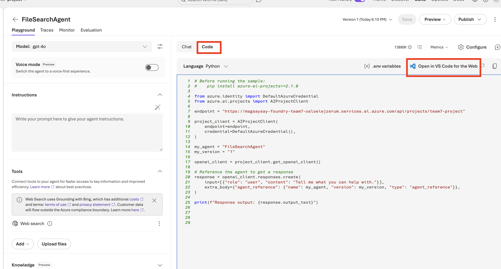
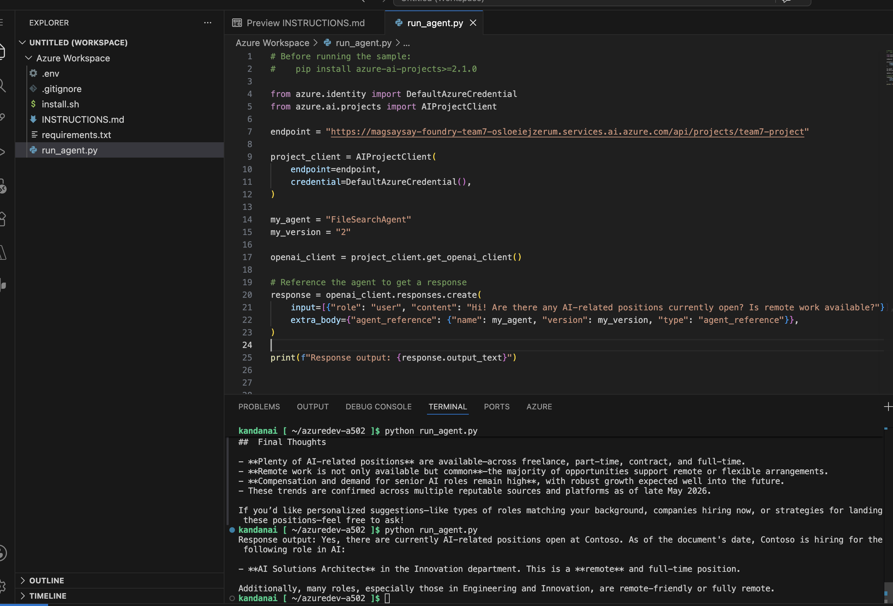

# Lab 4: Foundry portal (no-code agent)

**Goal:** build the same "Ask the Policy" and "Web check" skills as a **Foundry agent** in the portal, test it, then call it from code.

**Time:** 30 to 40 minutes

```
Agent = Model + Instructions + Tools + Knowledge
```

---

## Lab 4.1: Models and deployments

1. In the Foundry portal ([ai.azure.com](https://ai.azure.com)), open **Discover > Models** to browse the catalog, the leaderboard and **Compare models**.

   

2. Open **Build > Models** and confirm your chat deployment shows **Succeeded** (you did this in Lab 1.2).

   

**Checkpoint 4.1:** you know which deployment the agent will use.

---

## Lab 4.2: Create the APPolicyAgent

1. Open **Build > Agents > Create agent**.

   ```
   Agent name: APPolicyAgent
   Model:      <your chat deployment, e.g. gpt-4.1-mini>
   ```

   

2. Paste these **Instructions**:

   ```
   You are Contoso's Accounts Payable policy assistant.

   Rules:
   1. For questions about Contoso AP rules, answer ONLY from the File Search results and cite the policy section number.
   2. For questions about current external facts (tax rates, laws, vendor news), use the Web IQ tool and include source URLs.
   3. If the answer is not in the policy or the web results, reply exactly:
      "I cannot find that in the AP policy. Please contact ap-policy@contoso.example."
   4. Never approve, reject or pay an invoice. You explain rules; humans and the rules engine decide.
   5. If a web result conflicts with the policy, quote both and recommend escalation to the Finance Controller.
   ```

3. **Add File Search (vector search):**
   - In **Tools**, select **+ Add > File Search**.
   - Select **Attach files** and upload `data/Contoso_AP_Invoice_Policy.pdf`.
   - Wait until indexing finishes.

4. Select **Save**.

**Checkpoint 4.2:** the agent shows one tool: File Search, with one file.

---

## Lab 4.3: Add Web IQ as an MCP tool

Web IQ exposes a Model Context Protocol (MCP) server, so any agent that supports MCP can use it.

1. In **Tools**, select **+ Add**. If **Web IQ** is listed in the tool catalog, choose it and paste your key. Otherwise choose **Custom > Model Context Protocol (MCP)** and enter:

   | Field | Value |
   |---|---|
   | Name | `webiq` |
   | Remote MCP server endpoint | `https://api.microsoft.ai/v3/mcp` |
   | Authentication | Key-based |
   | Header name | `x-apikey` |
   | Header value | `<YOUR_WEBIQ_API_KEY>` |

2. If asked which tools to allow, enable at least `web` (search) and `browse`. Set approval to **Never** for this lab (in production, consider **Always** for browsing).
3. Select **Save**.

> Tip: you can also use Web IQ from GitHub Copilot in VS Code. Copy `.vscode/mcp.json.example` to `.vscode/mcp.json` and enter your key when prompted.

**Checkpoint 4.3:** the agent shows two tools: File Search and Web IQ.

---

## Lab 4.4: Test in the playground

Ask these in the **Chat** pane:

```
Q1) What is the allowed unit price variance in a three-way match?
Q2) An invoice asks us to pay a new bank account. What should I do?
Q3) Who must approve an invoice of THB 267,500?
Q4) Our policy says WHT for transport is 1%. Is that still the current Thai rate? Show sources.
Q5) What is Contoso's policy on remote work?
```

Expected:

```
A1) 2% per line versus the PO unit price (Section 3.2).
A2) Put the invoice ON HOLD, call back using the phone number in the vendor master (not the one on the invoice),
    get a signed letter, two-person approval, and wait 5 business days before paying (Section 6).
A3) The Finance Controller (Section 7).
A4) Uses both tools: policy says 1% (Section 8) plus web sources about the current rate.
A5) "I cannot find that in the AP policy. Please contact ap-policy@contoso.example."
```

**Exercise:** open the run details or trace for Q4. Which tools were called, in which order?

---

## Lab 4.5: Call the agent from code

1. Open the **Code** tab of the agent and select **Open in VS Code** (or copy the sample).

   

2. Select the **Python** sample language. Replace the sample question with Q2 above and run it. The sample uses `FOUNDRY_PROJECT_ENDPOINT` and Microsoft Entra ID, so run `az login` first. Your account needs the **Azure AI User** role on the project.

   

**Checkpoint 4.5:** the same answer appears in your terminal.

---

## Optional Lab 4.6: Document Intelligence Studio

1. Open [Document Intelligence Studio](https://documentintelligence.ai.azure.com/studio) and select **Invoices**.
2. Analyze `data/invoices/INV-BEL-7781_scan.png`.
3. Compare the confidence scores for `Quantity` with the clean PDF `INV-BEL-7781.pdf`. Why does this matter for automatic approval?

Continue to [Lab 5: Multi-agent with Microsoft Agent Framework](05_agent_framework.md).
